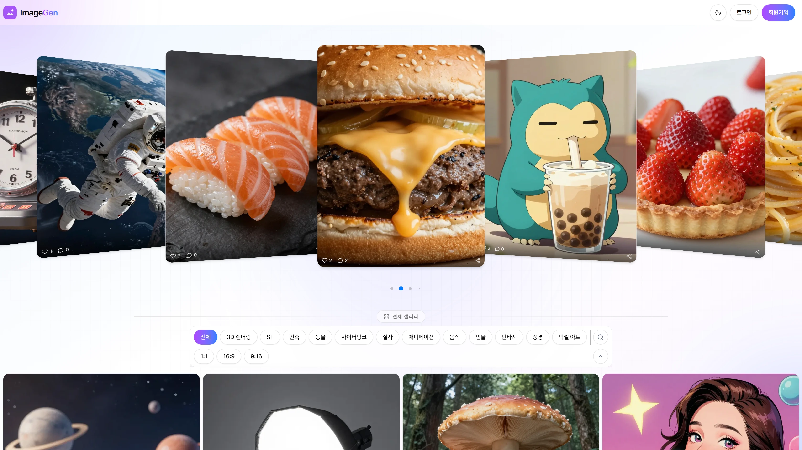
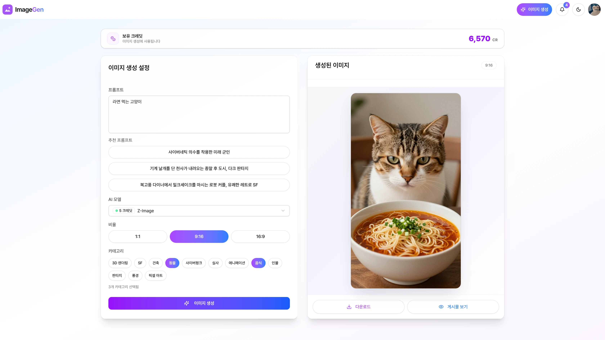
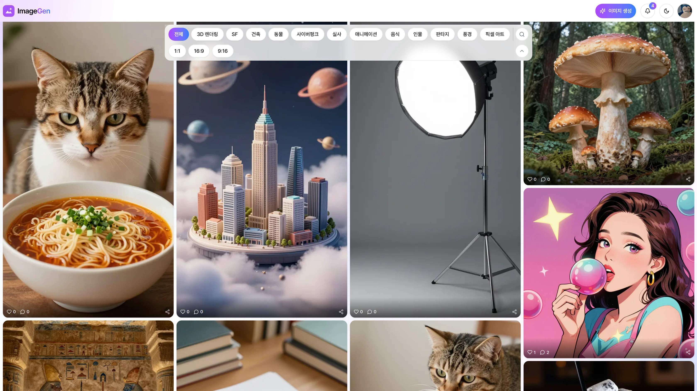
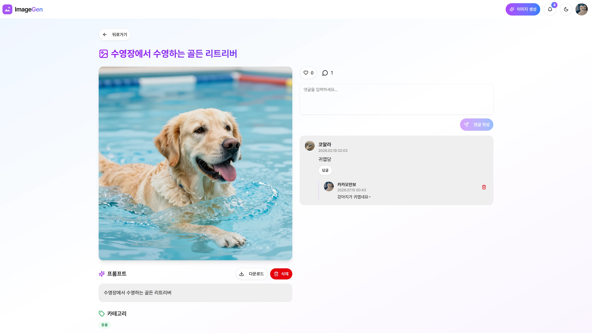
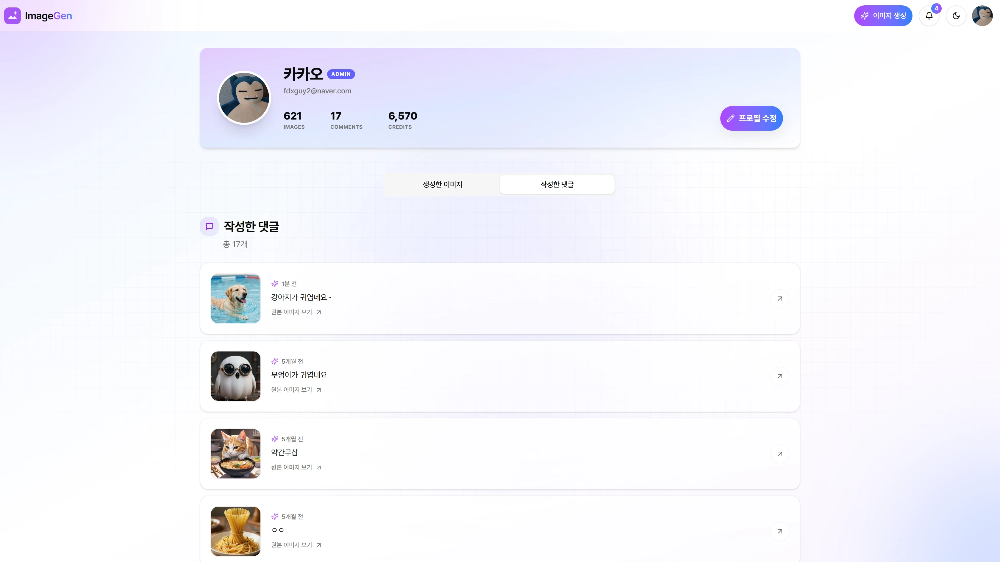
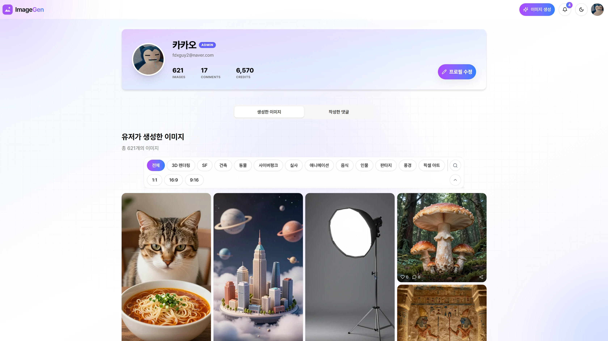
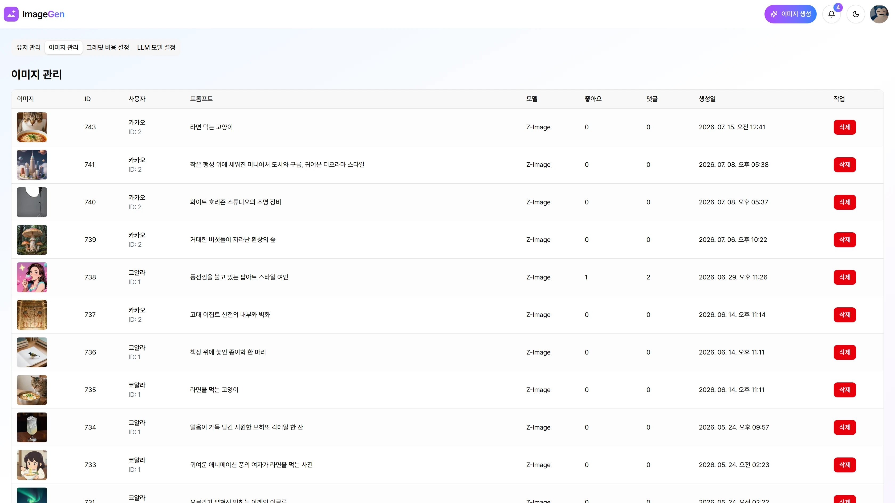
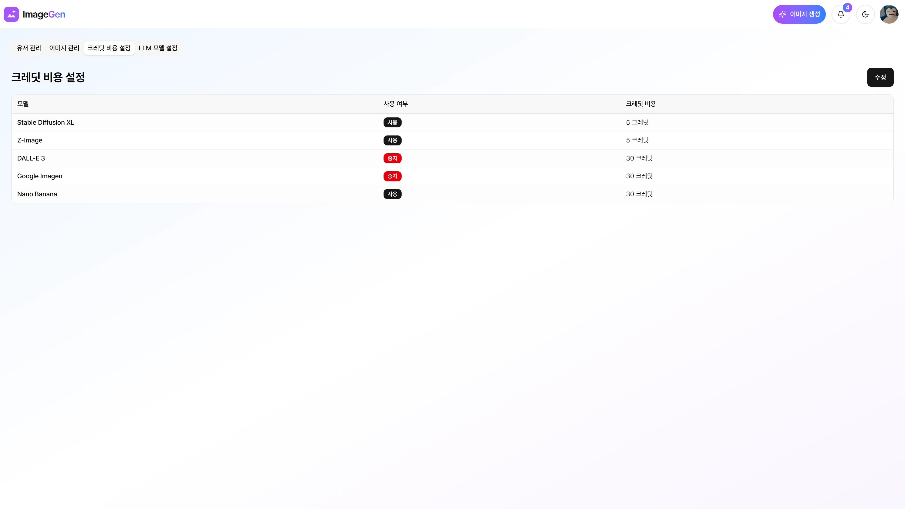

# ImageGen - AI 이미지 생성 서비스

Next.js와 여러 이미지 모델을 사용한 AI 이미지 생성 웹 애플리케이션입니다.

## 주요 기능

- API와 로컬 모델을 사용하여 AI 이미지 생성 (api - DALL-E 3, Google Imagen, Nano Banana | local - Stable Diffusion XL, Z Image Turbo)
- 이미지 생성 시 공유
- 좋아요 및 댓글 추가
- 프로필 조회 및 수정
- 관리자 대시보드 (유저/이미지 관리, 크레딧 비용 및 LLM 모델 설정)

## 🏗️ 인프라 아키텍처 및 특징

클라우드 비용 절감과 고성능 AI 모델 서빙을 위해 **Home Lab(On-Premise)** 환경을 구축했습니다.

### Why Self-Hosted?
- **비용 효율성:** 고사양 GPU가 필요한 AI 이미지 생성 모델을 AWS g5 인스턴스 등으로 구동 시 발생하는 막대한 비용을 로컬 데스크톱(RTX 5090기반)을 활용해 절감했습니다.
- **데이터 주권:** 생성된 이미지와 프롬프트 데이터를 로컬 DB(MySQL)에 직접 저장하여 관리합니다.

### Network & Security
- **WSL2 Mirroring Mode:** 윈도우 호스트와 WSL 간의 네트워크 장벽을 없애기 위해 미러링 모드를 적용, 복잡한 포트포워딩 설정 없이 `localhost` 통신 환경을 최적화했습니다.
- **Reverse Proxy (Nginx):** - SSL 인증서 적용 (HTTPS)
  - 내부 포트(3000, 3306 등) 외부 노출 차단
- **Port Forwarding:** 공유기 단에서 80/443 포트만 개방하여 보안 위협을 최소화했습니다.

### CI/CD Pipeline
- **GitHub Actions Self-hosted Runner:** - 외부에서 로컬 서버로의 직접 접속(SSH) 없이, Runner가 GitHub의 Job을 가져오는(Polling) 방식으로 보안을 강화했습니다.
  - `Push` -> `Build` -> `PM2 Reload` 과정을 완전 자동화하여 무중단 배포 환경을 구현했습니다.

## 기술 스택

- **Frontend**: Next.js 16, React 19.2, TypeScript
- **Styling**: Tailwind CSS, shadcn/ui
- **Database**: MySQL (Prisma ORM)
- **AI Service**: OpenAI API, Google Imagen API, Stable Diffusion, Ollama
- **Authentication**: JWT, bcryptjs
- **State Management**: TanStack Query, Zustand

### JEV 카테고리 추천

서버 환경에 `TYPESAFE_API_KEY`를 설정하면 카테고리 추천 API가 JEV를 사용합니다. 로컬 개발은 `.env.local`, 배포 서버는 배포 워크플로가 읽는 `~/.env.next`에 설정합니다. 키가 없거나 JEV 요청이 실패하면 기존 Gemini/Ollama 추천으로 전환됩니다. 이미지 생성용 프롬프트 변환은 기존 LLM 설정을 계속 사용합니다.

관리자 페이지의 **LLM 모델 설정 → 선정성 프롬프트 필터**를 켜면 NSFW 허용 모델의 이미지 생성과 편집 요청 전에 JEV가 입력 프롬프트를 검사합니다. 현재 대상은 Qwen Image 2.1만이며, 대상 목록은 `constants/model.constants.ts`의 `NSFW_CAPABLE_MODELS`에서 관리합니다. 다른 모델에서는 필터 설정용 DB 조회와 JEV 호출을 건너뜁니다. 기본값은 꺼짐이며, 켠 상태에서 JEV를 사용할 수 없으면 대상 모델의 생성 요청을 중단합니다. 필터 기준은 `lib/services/image/promptSafetyService.ts`의 `SEXUAL_CONTENT_THRESHOLD`에서 조정할 수 있습니다.

### Qwen Image 2.1 영역 편집

이미지 편집 탭에서 **편집 영역 지정**을 켜면 원본 위에 브러시로 칠한 부분만 새로 생성하고 나머지는 원본 픽셀을 그대로 유지합니다. 브라우저가 칠한 영역을 흑백 PNG 마스크로 만들어 `mask` 필드로 전송하고, 서버는 `lib/services/image/qwen-image-21-mask-edit-workflow.json`을 사용합니다.

참고 이미지는 `constants/model.constants.ts`의 `MAX_REFERENCE_IMAGES`장까지 넣을 수 있고 지시문에서 `<image2>`, `<image3>` 순서로 가리킵니다(`<image1>`은 원본). `TextEncodeQwenImage21` 노드는 `image_16`까지 받지만 한 장마다 시퀀스가 길어져 VRAM과 생성 시간이 늘어나므로 기본값을 3으로 제한했습니다. 지시문이 언급하지 않은 참고 이미지는 모델이 무시하기 쉬워 `Use <imageN> as visual references.` 한 줄을 자동으로 덧붙입니다.

편집 지시문은 `llmService.translateEditInstruction`으로 영어 명령문 한 줄로 바꿔서 모델에 넘깁니다. 생성용 `translateText`는 SDXL 키워드 나열을 만들기 때문에 편집 모델에는 쓸 수 없습니다. "지워줘"처럼 무엇으로 채울지 말하지 않은 제거 요청은 `constants/llm.constants.ts`의 `REMOVAL_INSTRUCTION`으로 치환합니다. LLM은 이미지를 볼 수 없어 대체할 내용을 스스로 지어내면 엉뚱한 결과가 나오기 때문입니다. 관리자 **LLM 모델 설정 → 번역**이 꺼져 있으면 원문이 그대로 전달되며, 이때 한국어 지시문은 결과가 크게 나빠집니다.

이 워크플로는 원본을 약 1MP·32 배수 크기로 맞춘 뒤 VAE로 인코딩한 latent에 노이즈 마스크를 걸어 샘플링하고, 마지막에 `ImageCompositeMasked`로 마스크 밖 영역을 원본으로 되돌립니다. `TextEncodeQwenImage21`의 latent 출력은 빈 latent라 마스크 편집의 기준으로 쓸 수 없으므로 `VAEEncode`를 따로 둔 구조입니다. 경계 번짐은 `GrowMask`/`FeatherMask`의 픽셀 값으로 조정합니다.

## 라이선스

MIT License
